# Map-name sharpness comparison

Side-by-side raw client screenshots; no image editing or montage. Compare glyph edge sharpness and horizontal/vertical proportions to catch blur or anisotropic squeezing, not readability alone. Baseline is the previously published 6b80fa42 evidence set; after images come from this verification run.

Baseline evidence: [eea8f7d2cb66096db7b18c766d71cde8c5ada057](https://raw.githubusercontent.com/Blaaszkovsky/MuMain/eea8f7d2cb66096db7b18c766d71cde8c5ada057/README.md).

| Capture | Before — 6b80fa42 | After — final sharpness build |
|---|---|---|
| Lorencia / legacy / 100% / 1600x900 |  SHA-256 `0363a9bd65e8c812b2bcde2fc8cedfb73439acadc49a5b44c74e20917d200237` | [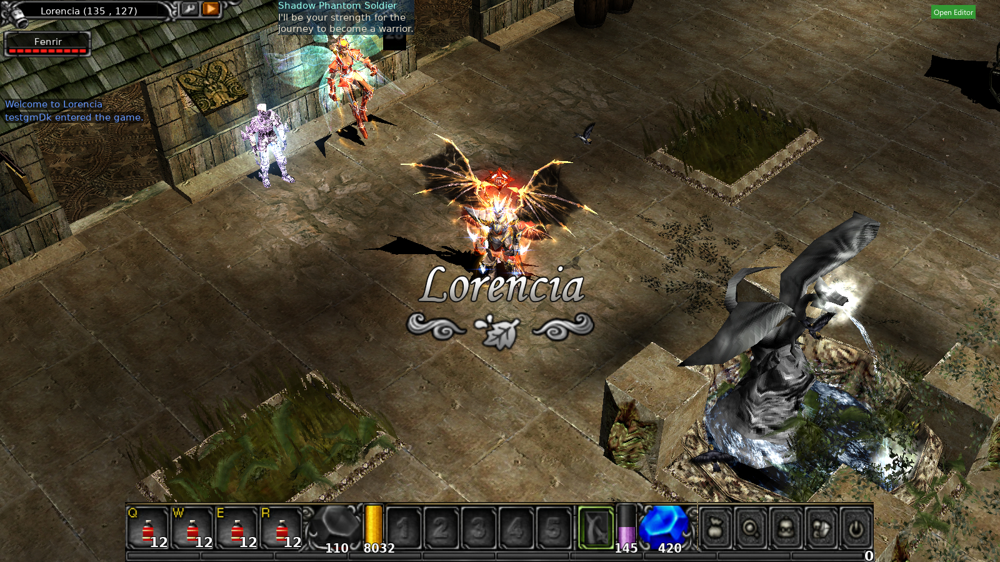](screenshots/main-legacy-en-100-1600x900-lorencia.jpg) SHA-256 `e1cc0d758d809711ce7f97ee9f4ab26c74e67ccf229f8baf838b3a37019fc99f` |
| Balgass / modern / 100% / 1600x900 |  SHA-256 `d217fcff365262c80ef1ae1ab5e9d3448ad02b9ffb7ab4c2c7b682df7ee9226c` | [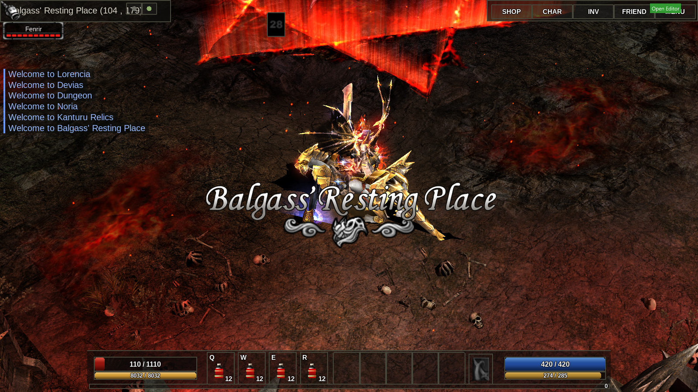](screenshots/main-modern-en-100-1600x900-balgass42.jpg) SHA-256 `33ed792770173d6d9c3a26579923eeb8d14953deb3c79a1fdb918dc912ff1523` |
| Kanturu / legacy / 75% / 1280x720 |  SHA-256 `735d3367f46b5535a12dd7a5cbd50da1394f278f546ac621075ab14c138f8d10` | [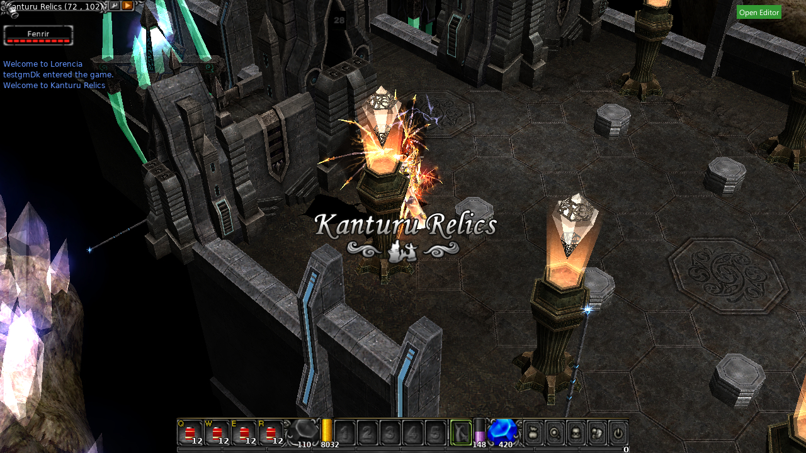](screenshots/main-legacy-en-75-1280x720-kanturu38.jpg) SHA-256 `0600e3fc8db94e8eee7f92e5a57b815ec01c19c7e1d3410fd46ac7a52b164d4f` |
| Kanturu / modern / 150% / 800x600 |  SHA-256 `a5d6f3946200104f65e5987c5cdeb05ac845fa7e28fbf23dc23838550050dfb8` | [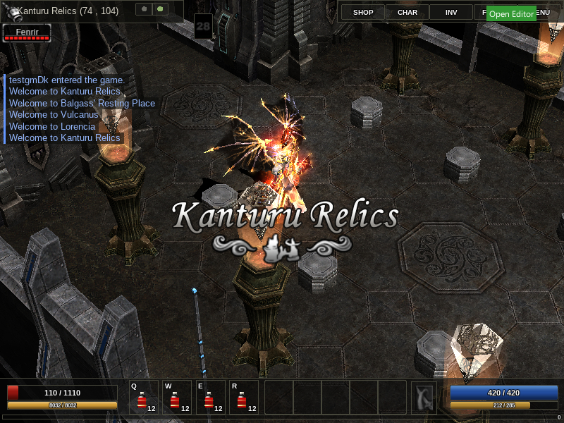](screenshots/main-modern-en-150-800x600-kanturu38.jpg) SHA-256 `5355827cf8ed8d69292a63aff9f33a61f6436517c6ba3a4a4f724c9a726174bb` |
| Japanese Kanturu / legacy |  SHA-256 `f102e2b5044bbf2fc70ceca09a46a048d03f3c539efb6f2cd0ba8a58c9c074f1` | [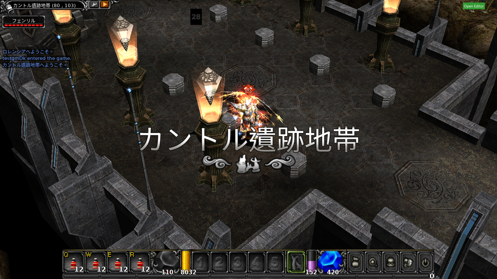](screenshots/locale-legacy-ja-100-1600x900-kanturu38.jpg) SHA-256 `ba7d7203cbbdf8c8edf69bcae33145b5e53aa413cef8f11bc22ac025c9154d1f` |
| Japanese Kanturu / modern |  SHA-256 `8f40c3155d0fe01cf666d1b63ca2e49215890b5161266b64cf77f1f3c7cc23e0` | [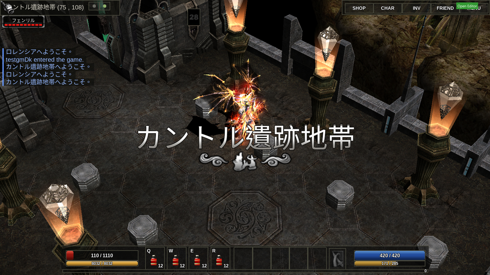](screenshots/locale-modern-ja-100-1600x900-kanturu38.jpg) SHA-256 `44ddcde0b8e8da5ba1ce1eca66e9a5b5c037cf7a5085f5c28e184828321f8a44` |
| Polish Lost Tower / legacy |  SHA-256 `ecb5eb94a1d27d06c66d3031fbf3f93d2c22220c250ca3f644f05a3839442d20` | [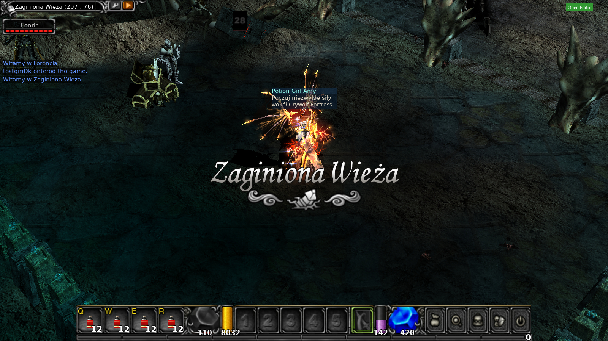](screenshots/locale-legacy-pl-100-1600x900-losttower4.jpg) SHA-256 `1228338bee94fdd143b9193f4b6e7ce207157796356688911fd5700a6d31d1a0` |
| Polish Lost Tower / modern |  SHA-256 `8d460cb1cc991fdde904cf0ae4562edcabaf5507f258f66d130a3429bb8aad4f` | [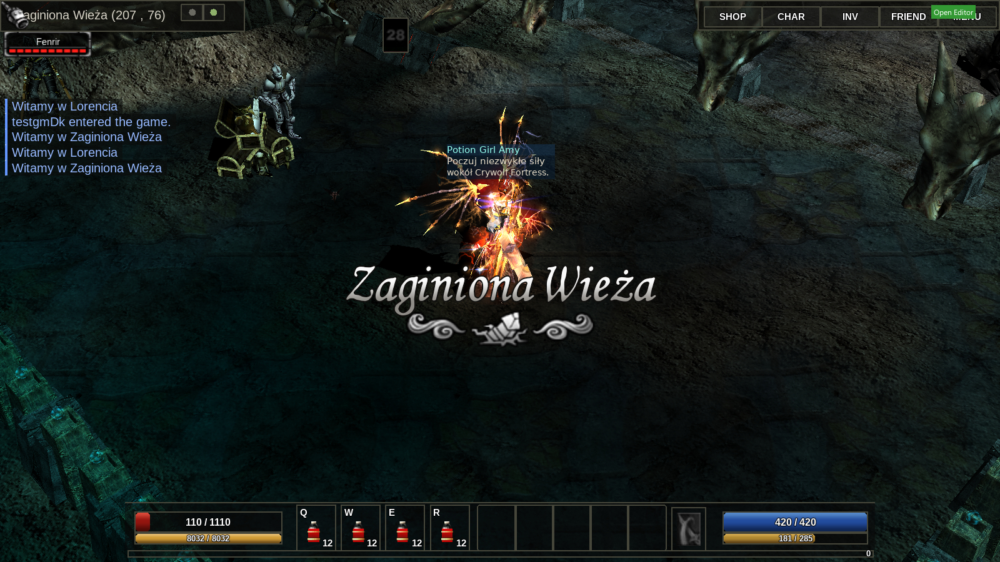](screenshots/locale-modern-pl-100-1600x900-losttower4.jpg) SHA-256 `b1aa5ed02432dea054131be906565316f5463b182d870b6e7300cca1bd7d4400` |
| Russian Kanturu / legacy |  SHA-256 `9b499f290fa1be26383e17a7acc120a145a73df2794266acc16667481d52a8cd` | [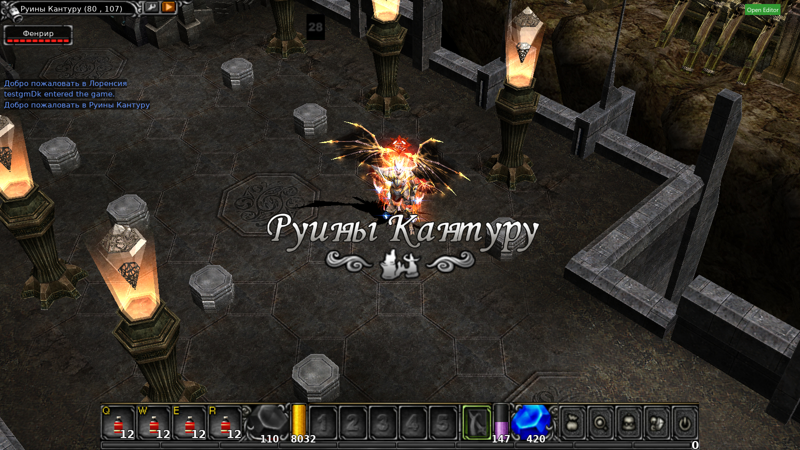](screenshots/locale-legacy-ru-100-1600x900-kanturu38.jpg) SHA-256 `ec9ed42313317f831755c5ffc1dd33d4e67cce61a00bd95ae55e2feb6de697c0` |
| Russian Kanturu / modern |  SHA-256 `4c00ce17546a86e495de50a2f9a59532ba02ef480a4fb0fbd144c028300c653a` | [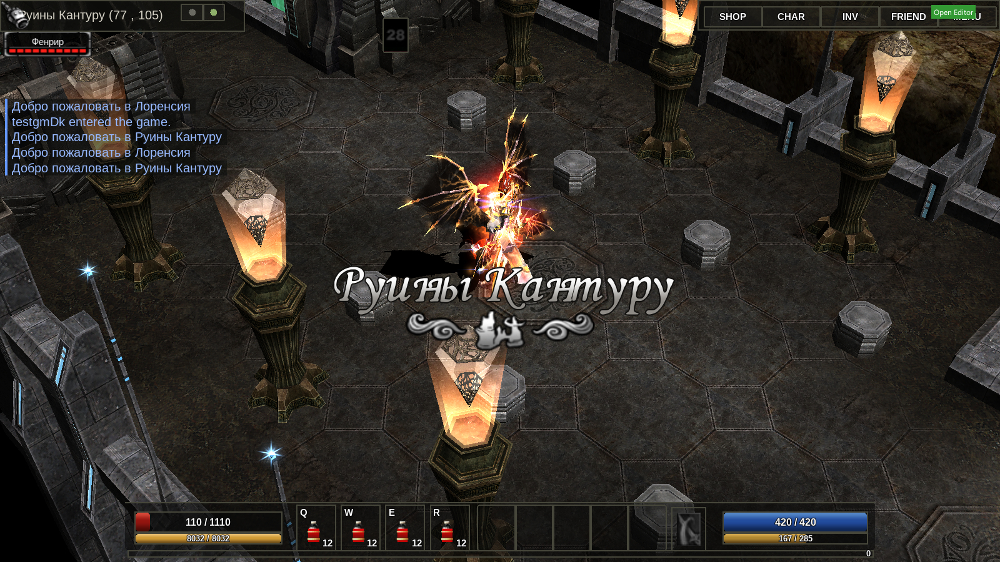](screenshots/locale-modern-ru-100-1600x900-kanturu38.jpg) SHA-256 `5f30d8b7b61b16e800c6e2e4d2db7c954ab8ee5f78dc9ce4f05126201d69ea3e` |
| Traditional Chinese Devias / legacy |  SHA-256 `b7255ee29182870644889779e68f08207c25f980ef499b5be6ae8288b1aff8bc` | [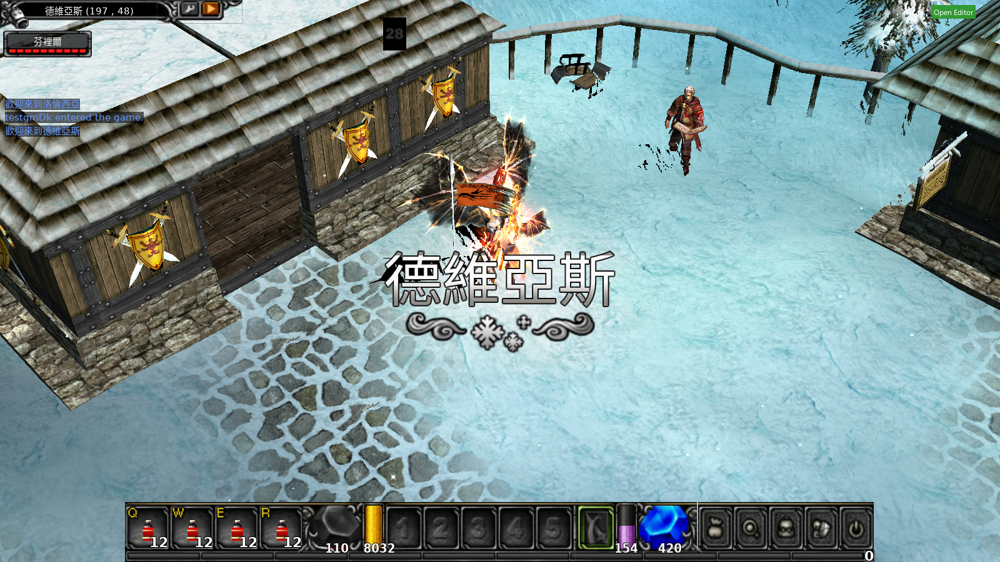](screenshots/locale-legacy-zh-tw-100-1600x900-devias.jpg) SHA-256 `df53e2d2799271c27538a3ff7eb6e243fc02cbc5a7bf3ee3b9e08bcee8dfdb04` |
| Traditional Chinese Devias / modern |  SHA-256 `20e40016a7718879e6aa4eac4a7aa6505fedc383605ff275700cb8cc850d6792` | [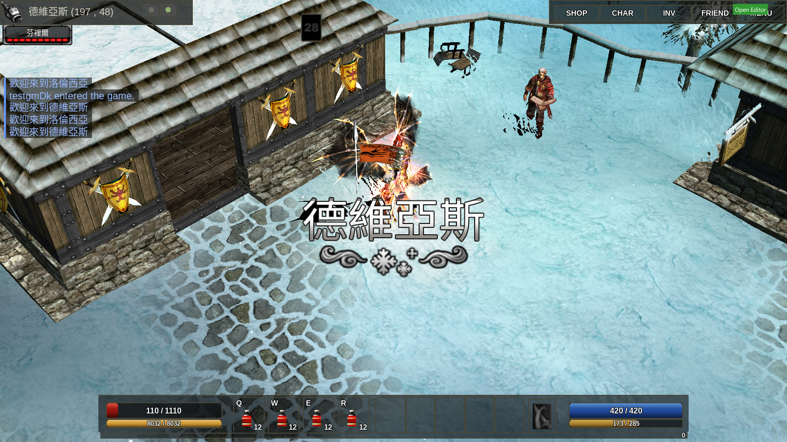](screenshots/locale-modern-zh-tw-100-1600x900-devias.jpg) SHA-256 `62a546b8cf4e18cd66103b28b324d7593e4b90f8c8d2be0d82153d377868ef39` |

## Fractional-scale sample

[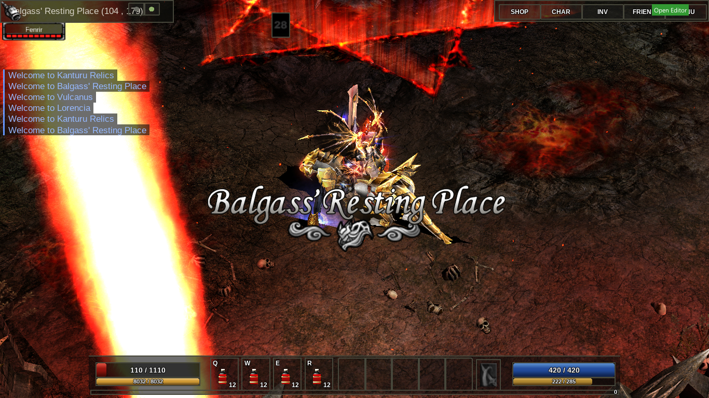](screenshots/main-modern-en-125-1366x768-balgass42.jpg)  
SHA-256 `948c64a930618fd96a840d675db12aced638962bd7b354007ad5cdce6e2a69cb`. No corresponding 125% baseline capture exists in the 6b evidence set.
